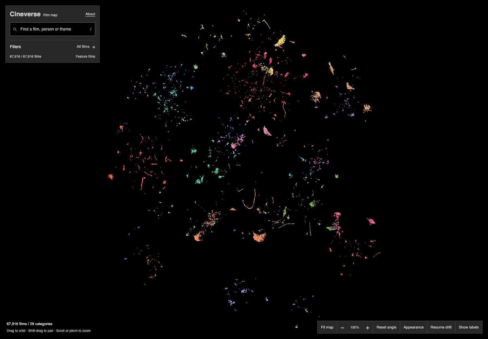
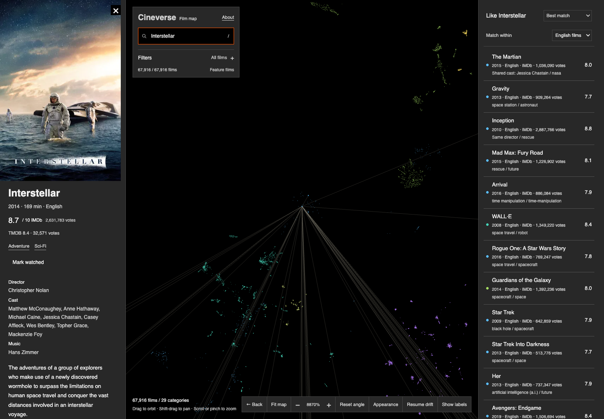

# Cineverse

**Find your next film by exploring how movies connect.**

[Explore Cineverse →](https://explorecineverse.pages.dev/)

Cineverse is an interactive movie map with more than 67,000 feature films. Explore clusters of related stories, search for a title or filmmaker, and move from the big picture into individual films.

## What you can do

- Explore a movie map that opens flat and reveals its depth as you zoom in.
- Search for films, actors, directors, composers, genres and themes.
- Discover related films, with attention to language, story and release era.
- Compare ratings and audience vote counts.
- View posters, film details and U.S. watch options.
- Mark films as watched to keep them out of future recommendations.
- Explore on desktop or phone.

## Try it

Open **[explorecineverse.pages.dev](https://explorecineverse.pages.dev/)**. Search for a film you know, select it, and explore its recommendations or nearby clusters.

Watched selections are saved in your browser. Movie metadata and streaming availability may vary by title.

## About this repository

This is a public project showcase. Cineverse's implementation, data pipelines, recommendation logic and deployment configuration are maintained privately.

Movie information includes data from IMDb and TMDB. Watch availability is provided by JustWatch via TMDB. Cineverse is not endorsed or certified by TMDB. Movie posters and third-party materials belong to their respective owners.
